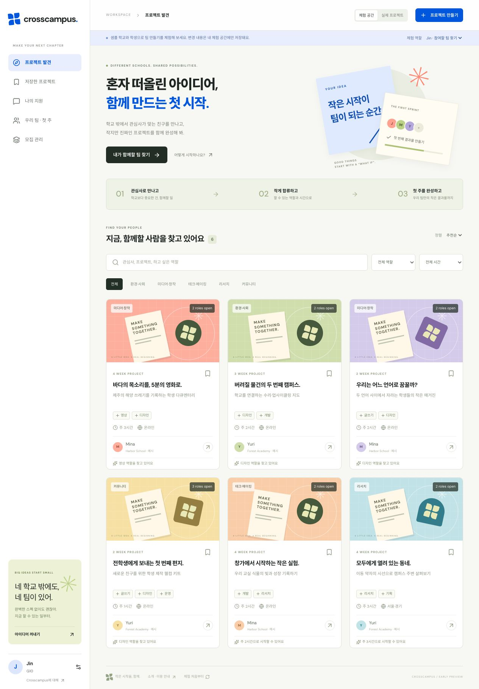

# Crosscampus

**Find your project team beyond your school.**

Crosscampus helps international-school students in Korea form small project teams around a concrete outcome, complementary roles, and time they can actually commit.

[Try the demo](https://crosscampus-kr.web.app) · [Product brief](docs/PRODUCT.md) · [Architecture](docs/ARCHITECTURE.md) · [Contributing](CONTRIBUTING.md)



## From an idea to a first sprint

A project listing should answer three questions: **What will we make? What can I contribute? What happens in the first week?** Crosscampus carries those answers through joining a team and planning its first steps.

| Step                | What the product does                                                                                 |
| ------------------- | ----------------------------------------------------------------------------------------------------- |
| Define the project  | Set an outcome, open roles, duration, language, and weekly hours.                                     |
| Find a contribution | Browse by interest, role, and availability; propose a specific first-week contribution.               |
| Build the team      | The leader reviews private proposals and accepts one member per role.                                 |
| Start together      | Acceptance opens a private kickoff board with a goal, meeting details, and role-specific first tasks. |

[Sprint outcomes and peer feedback](https://github.com/eonia89/crosscampus/issues/1) let team members record what they made, what they contributed and learned, and give each other feedback, visible only to the team.

## Try it

The public demo needs no account. Apply as **Jin**, switch to **Mina** to accept the proposal, then open **우리 팀 · 첫 주** to use the shared sprint board. Demo people, schools, and projects are fictional; changes stay in that browser.

Real projects use Google sign-in and an invitation list. Application notes are visible to the applicant and project leader. Sprint boards are visible only to team members.

## Run locally

Requires Node.js 24.12+ and npm 11.6.2. Java 21+ is needed for the Firestore emulator tests.

```sh
npm ci
npm run dev
```

Open `http://127.0.0.1:5173`. The demo works without cloud credentials. See [Contributing](CONTRIBUTING.md) for local authentication, sample invitations, and the review workflow.

```sh
npm test
npm run test:rules
npm run typecheck
npm run format:check
npm run build
```

## Implementation

React + TypeScript + Vite, Firebase Authentication, Firestore, and Firebase Hosting.

- `src/app.tsx` — product screens and forms
- `src/lib/domain.mjs` — pure validation, transitions, demo data, and matching explanations
- `src/lib/firebase-store.mjs` — live queries and transactions
- `src/firebase/client.ts` — authentication and demo/live routing
- `firestore.rules` — server-enforced access and data invariants
- `tests/` — domain and Firestore integration tests

The [architecture](docs/ARCHITECTURE.md) explains privacy boundaries and transaction behavior. [Verification](docs/VERIFICATION.md) records test coverage and known limits.

## Current stage

Working prototype with an invited live workspace. Student interviews and a real cross-school pilot are the next validation steps. The [product brief](docs/PRODUCT.md) describes the hypotheses, pilot plan, and decision criteria.
